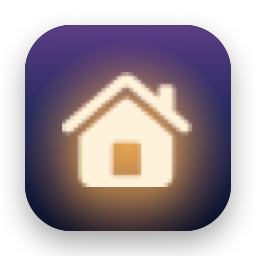
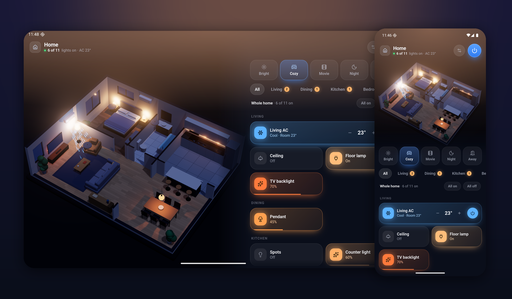
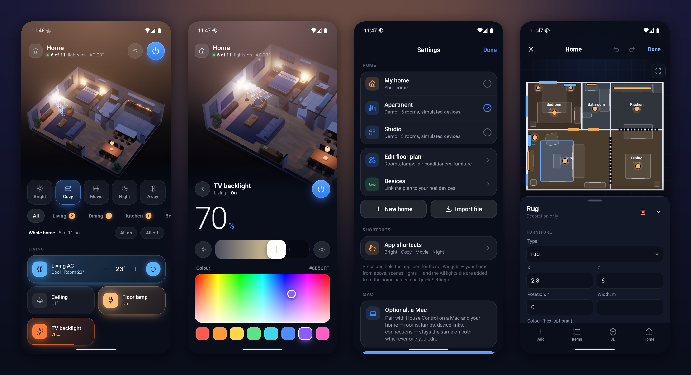
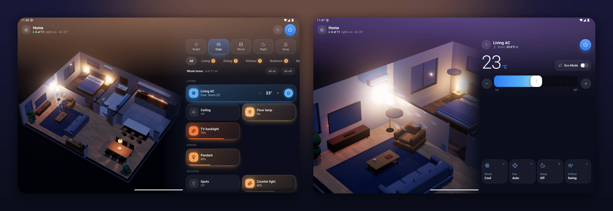
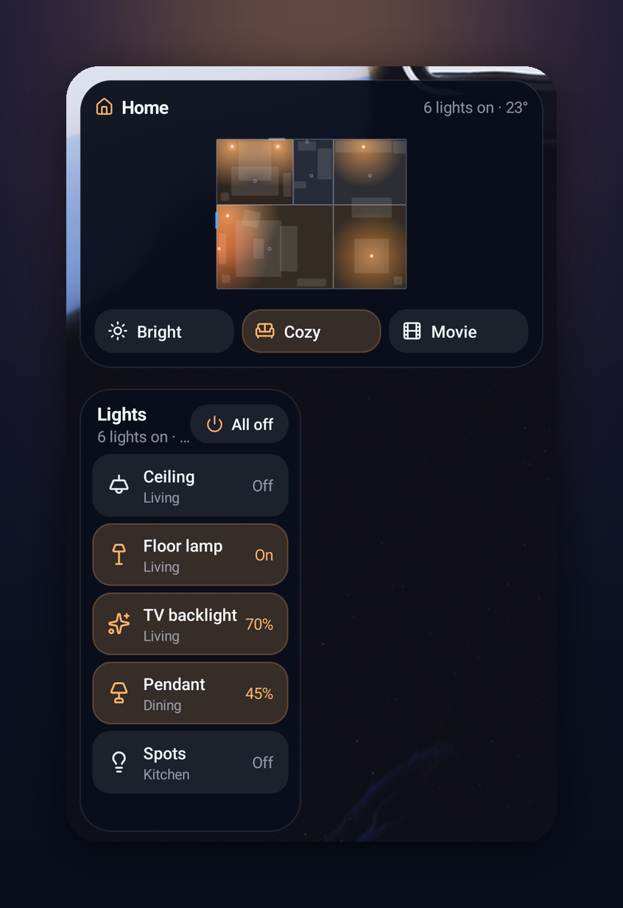

<p align="center">
  
</p>

<h1 align="center">House Control for Android</h1>

<p align="center">
  Your home as a live 3D model on your Android phone and tablet —<br>
  its lights, air conditioners and scenes, through Smart Life, Home Assistant and Philips Hue. No Mac needed.
</p>

<p align="center">
  <a href="#install"><b>Install</b></a> &nbsp;·&nbsp;
  <a href="#build-it-yourself"><b>Build it yourself</b></a> &nbsp;·&nbsp;
  <a href="#support-the-project"><b>Support the project</b></a>
</p>

<p align="center">
  Made by <a href="https://x.com/0xProbabillity">@0xProbabillity</a> · the Android sibling of
  <a href="https://github.com/0xProbabillity/house-control">House Control</a> for Mac and iPhone and
  <a href="https://github.com/0xProbabillity/house-control-tv">House Control TV</a>
</p>

<p align="center">
  
</p>

## What it does

- **Your floor plan in 3D.** Rooms, walls, doors, windows and furniture, drawn from one JSON plan — the same plan
  and the same renderer as House Control on the Mac and iPhone. Lamps light the scene the way they light the room;
  an air conditioner that runs blows visible air.
- **Lights.** Tap a lamp in the 3D view or its tile to toggle it, drag across a tile to dim, touch and hold for
  brightness, white temperature and colour.
- **Air conditioners.** Power, target temperature, mode, fan speed, swing, sleep and eco — whatever the unit offers —
  with the room temperature from a real sensor if you have one.
- **Scenes.** One tap sets every light and AC: "Cozy", "Movie", "Night", or your own.
- **A floor plan editor made for a finger.** Draw rooms, drop in furniture, place lamps and ACs, pinch to zoom,
  and link each one to a real device — all on the phone.
- **Your devices.** Smart Life / Tuya (scan a QR code with the Smart Life app, no developer account), Home
  Assistant (and the thousands of brands it runs) and Philips Hue, mixed freely in one home. Home Assistant
  servers and Hue Bridges on your Wi-Fi are found by themselves.
- **Widgets, shortcuts and a tile.** Your home from above with its lamps glowing, scenes, and a list of lights on
  the home screen; scenes in the app icon's menu; *All lights* in Quick Settings. Every tap switches the real
  devices without opening the app.
- **Phones and tablets, upright or on their side.** On its side the model gets the full height beside the panel.
- **Optional: your computer.** Pair with House Control on a Mac or a Windows PC and the floor plan, device links and the Home Assistant
  and Hue connections stay the same on both, whichever one you edit.
- **Works without any hardware.** Until you connect something, every device is simulated, so you can try
  everything first.

<p align="center">
  
</p>

<p align="center">
  
</p>

| Platform | How the phone connects |
| --- | --- |
| ✓ **Smart Life / Tuya** | Its own sign-in: a QR code you scan with the Smart Life app. Lights, plugs, Wi-Fi ACs and infrared ACs behind a blaster |
| ✓ **Home Assistant** | Your server's API on your network, with a long-lived access token. Found on the Wi-Fi by itself |
| ✓ **Philips Hue** | The Hue Bridge's local API (CLIP v2): press its button once. Found on the Wi-Fi by itself |
| — **Apple Home** | HomeKit exists only on Apple devices. Add HomeKit or Matter accessories to Home Assistant to switch them here |

## Install

1. Download `house-control-<version>.apk` from [Releases](../../releases).
2. Open it on the phone. Android asks once to allow installing apps from your browser or file manager:
   **Settings → Apps → Special app access → Install unknown apps**.
3. Open **House Control**. It starts with a welcome screen and a demo home, so you can look around first.

Or with a computer and [ADB](https://developer.android.com/tools/releases/platform-tools):

```bash
adb install -r house-control-1.0.0.apk
```

Every release lists the APK's SHA-256 and the fingerprint of the certificate it is signed with, so you can check
what you downloaded:

```bash
shasum -a 256 house-control-1.0.0.apk
apksigner verify --print-certs house-control-1.0.0.apk
```

### Requirements

| | |
| --- | --- |
| Android | 8.0 (API 26) or newer, phone or tablet |
| WebView | Android System WebView or Chrome 100 or newer (the Play Store keeps it current) |
| Graphics | OpenGL ES 3.0 — every phone from the last decade |

## Set it up

Everything is set up on the phone, in **Settings** (the sliders button at the top of the panel):

- **New home** starts your own plan — one room, or the Studio or Apartment layout to adapt — and opens the editor.
  **Import file** takes a plan JSON exported from House Control anywhere ([format](https://github.com/0xProbabillity/house-control/blob/main/docs/floor-plan.md)).
- **Edit floor plan** is House Control's editor laid out for a finger: tap a room, lamp or AC to select it, drag
  what is selected, drag anywhere else to pan, pinch to zoom. **Add**, **Items**, **3D** and **Home** sit along the
  bottom; **Done** saves. Android's back button closes a sheet, then the editor (asking about unsaved changes).
- **Devices** lists every lamp and AC of the plan by room; tap one and pick its real device from everything your
  connected platforms have, or **Add devices to a room** to put several in at once, already linked.
- **Smart Life**, **Home Assistant** and **Philips Hue** connect right there.

### Smart Life

Enter the User Code from *Smart Life → Me → Settings → Account and Security* and choose **Show sign-in code**. The
code has to be scanned by the Smart Life app — which is usually on the very phone you are holding. So **Save code to
the gallery**, then in Smart Life tap **+ → Scan**, then the album icon, and pick the code. **Share code** sends it to
any other screen, and a paired Mac or PC shows it by itself. The session stays on the phone, encrypted with a key that
never leaves it; Smart Life is read every 12 seconds while the app is open.

### Home Assistant

Servers on the Wi-Fi are listed by themselves; tap one, or type the address (for example
`http://homeassistant.local:8123`). Paste a long-lived access token from your profile in Home Assistant →
*Security* → *Long-lived access tokens*. `light.*` and `switch.*` entities become lamps, `climate.*` entities become
air conditioners, and temperature sensors can be an AC's room thermometer. Changes made elsewhere arrive at once
over Home Assistant's WebSocket.

### Philips Hue

Choose **Pair** next to the bridge (or type its address from the Hue app → *Settings → My Hue system*), then press
the round button on the bridge within a minute. Lamps, light strips and plugs work; the thermometer in a Hue motion
sensor can be an AC's room temperature. The bridge's event stream brings changes made in the Hue app at once.

### Sync with a Mac or PC (optional)

The phone pairs with [House Control](https://github.com/0xProbabillity/house-control) on a Mac or with
[House Control for Windows](https://github.com/0xProbabillity/house-control-windows) on a PC, in the same way.

1. On the computer: right-click the House Control icon — in the menu bar on a Mac, in the taskbar's tray on a PC —
   → **Pair Phone…** (**Pair iPhone…** in older versions). A QR code appears.
2. On the phone: **Settings → Pair with Mac or PC → Scan the code** (or **Paste pairing link** after **Copy Pairing
   Link** on the computer).

From then on, whenever both are on the same Wi-Fi and the app is open, a plan saved on one reaches the other a
moment later. A home set up on the phone first goes to the computer. If both changed the plan while apart, the phone asks
which one to keep. Home Assistant and Hue connections travel too; a Smart Life session does not (Tuya rotates its
tokens), but the computer fills in the User Code for you.

Nothing goes through a server: the phone finds the computer with DNS-SD (Bonjour) and the two talk over TLS 1.2 with a
pre-shared key that only the QR code carries (`TLS_PSK_WITH_AES_128_GCM_SHA256`, the same as the iPhone app), so a
device that never saw the code cannot connect.

## Widgets, shortcuts and Quick Settings



- **Home** — your home from above, every lamp that is on glowing in its own colour, its status and its scenes.
  Tap the plan to open the app.
- **Scenes** — one tap sets every light and air conditioner.
- **Lights** — every lamp with its brightness; tap to switch one, or all of them at once.
- **All lights** — a Quick Settings tile: everything off (or on) from the notification shade.
- **App shortcuts** — press and hold the app icon for your scenes; choose which ones (scenes, lamps, *All lights
  off*) in **Settings → App shortcuts**, and drag one out to keep it on the home screen.

A widget switches the devices itself, without opening the app: it sends the commands to Smart Life, Home Assistant
or Hue straight away, and the panel shows the new state the next time it opens.
<br clear="right">

## Privacy and security

House Control talks to the platforms you connect — Tuya's servers for Smart Life, your own Home Assistant, your Hue
Bridge — to your paired Mac or PC, and to nothing else. There is no account, no analytics and no backend of its own.

- The floor plan lives in the app's private storage.
- The Smart Life session, the Home Assistant token, the Hue key and the computer's pairing key are encrypted with AES-GCM
  under a non-exportable Android Keystore key, and are left out of backups. **Sign out** / **Disconnect** /
  **Unpair** delete them. No log contains a token or a key.
- The Hue Bridge's certificate is self-signed: the phone trusts it when pairing, remembers its SHA-256 fingerprint
  and refuses any other device at that address afterwards.
- Home Assistant is usually reached over plain `http://` on the home network, so the app allows cleartext traffic;
  use `https://` for a server reached over the internet.
- The web UI is bundled with the app and served from its own assets; it never loads anything from the internet.

## Build it yourself

You need JDK 17, the Android SDK (platform 36, build-tools 36) and Node.js 20.19+ or 22.12+.

```bash
git clone https://github.com/0xProbabillity/house-control-android.git
cd house-control-android
./gradlew assembleDebug
adb install -r app/build/outputs/apk/debug/app-debug.apk
```

The first build installs the web UI's npm packages; Gradle builds the web UI with Vite and packs it into the app.
A debug build installs next to a release one (`dev.housecontrol.android.debug`).

A signed release build reads its key from `.signing/release.properties` (`storeFile`, `storePassword`, `keyAlias`,
`keyPassword`) or the `HOUSE_SIGNING_*` environment variables, neither of which is part of the repository:

```bash
./gradlew assembleRelease
```

Try it in the emulator:

```bash
sdkmanager "system-images;android-36;google_apis;arm64-v8a"
avdmanager create avd -n house -k "system-images;android-36;google_apis;arm64-v8a" -d pixel_8
emulator -avd house &
./gradlew installDebug
```

An emulator cannot see the Mac's Bonjour advertisement. Point a debug build at the Mac directly instead:
`adb shell am start -n dev.housecontrol.android.debug/dev.housecontrol.android.MainActivity --es syncEndpoint 10.0.2.2:<port>`.

## Development

```
app/      the Android app (Kotlin): the web UI in a WebView with its JSON bridge, the native screens (Jetpack
          Compose), the device platforms, the Mac sync, widgets (Glance), shortcuts and the Quick Settings tile
web/      the UI from House Control: Three.js scene, panel and editor (Vite), with the Android bridge and layouts
scripts/  make-icons.mjs turns the Lucide icons the web UI uses into Android vector drawables
docs/     screenshots
```

The device platforms are a Kotlin port of House Control's Swift core (`DeviceHub`, Home Assistant, Hue, Smart Life
and Tuya, the infrared remote, the plan editor, the widget snapshot and the sync protocol). The unit tests run the
same cases as the Swift tests — including the Smart Life envelope against a CryptoKit vector — and a TLS-PSK
handshake against a server like the Mac's:

```bash
./gradlew testDebugUnitTest
```

Work on the UI in a browser with hot reload; the native bridge is a no-op there and all devices are simulated:

```bash
cd web && npm install && npm run dev
```

Then open `http://localhost:5199/?platform=android`. Add `&mode=editor` for the editor or `&plan=studio` for the
second demo plan. The web UI comes from [House Control](https://github.com/0xProbabillity/house-control) (revision
in `UPSTREAM-REVISION`, license in `UPSTREAM-LICENSE`).

## Support the project

<picture>
  <source media="(prefers-color-scheme: dark)" srcset="docs/support/banner-dark.svg">
  <source media="(prefers-color-scheme: light)" srcset="docs/support/banner-light.svg">
  
</picture>

House Control is free and has no ads. If it earned a place on your phone, a tip in crypto
helps it keep growing: more devices, more platforms, quicker fixes. Thank you! A star, a bug report or a
pull request helps just as much.

Scan a code with your wallet, or copy an address with the button in the corner of its box.

> [!IMPORTANT]
> Send each coin only over the network named next to its address. Coins sent over another network may be lost.

<table>
  <tr>
    <td align="center" width="196">
      
    </td>
    <td>
      &nbsp;
      <b>Bitcoin</b>
      <br><sub>BTC · native SegWit (bech32) address</sub>

```text
bc1q07hfz95crdalcrnywjavdpc4pdvllct83as5re
```

</td>
  </tr>
  <tr>
    <td align="center" width="196">
      
    </td>
    <td>
      
      
      
      &nbsp;
      <b>Ethereum · Base · BNB Chain · Arbitrum</b>
      <br><sub>One address on all four networks · ETH, BNB, USDT, USDC and other tokens</sub>

```text
0x4ed3aF428e938a0CC8e60df86D714B4a7F0928F0
```

</td>
  </tr>
  <tr>
    <td align="center" width="196">
      
    </td>
    <td>
      &nbsp;
      <b>TON</b>
      <br><sub>Toncoin and USDT on TON · no memo needed</sub>

```text
UQBCDKDp11tBIwTon4ItzTPcQgNGcaqTM6Gn31KwSN7qWdmM
```

</td>
  </tr>
  <tr>
    <td align="center" width="196">
      
    </td>
    <td>
      &nbsp;
      <b>TRON</b>
      <br><sub>TRX and USDT (TRC-20)</sub>

```text
TWtWLJp2Hc6242RynhU1B4Uujru3tppb3B
```

</td>
  </tr>
</table>

## Acknowledgements and disclaimer

The Smart Life sign-in follows Tuya's open-source
[`tuya-device-sharing-sdk`](https://github.com/tuya/tuya-device-sharing-sdk), the library behind the Tuya
integration in Home Assistant, as House Control does. The 3D view is built with [Three.js](https://threejs.org); the
icons are from [Lucide](https://lucide.dev); the encrypted link to the Mac uses [Bouncy Castle](https://www.bouncycastle.org);
QR codes are made and read with [ZXing](https://github.com/zxing/zxing). The network logos under
[Support the project](#support-the-project) are from [Web3 Icons](https://github.com/0xa3k5/web3icons) (MIT).

This project is not affiliated with or endorsed by Tuya, Smart Life, Home Assistant, Signify (Philips Hue), Google
or Apple. It relies on interfaces these companies can change at any time. Use it at your own risk.

## License

[MIT](LICENSE)
