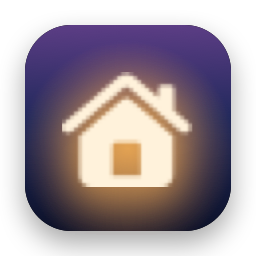
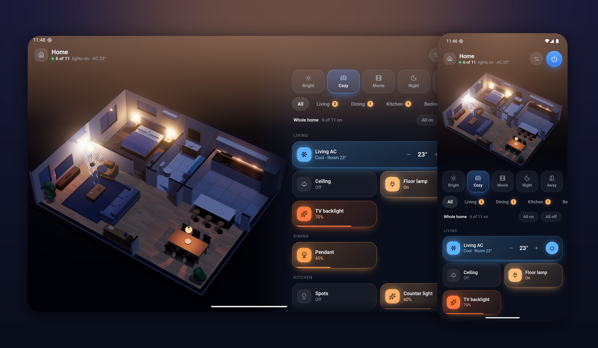
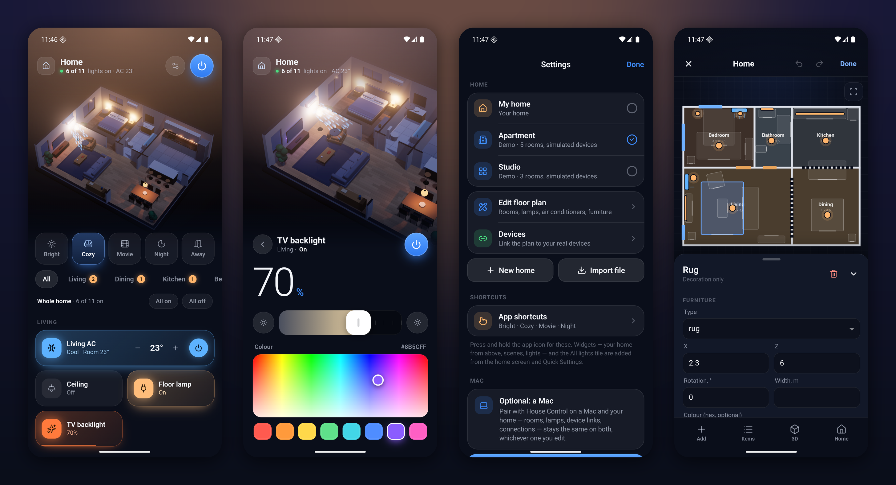
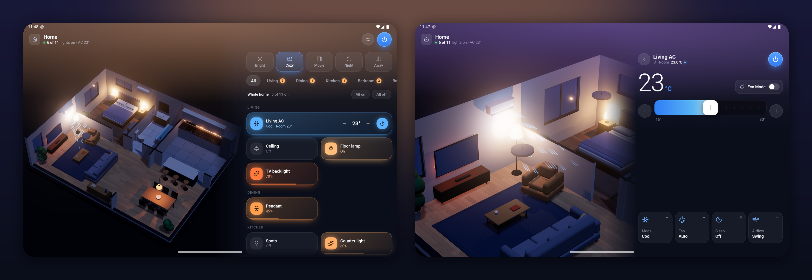
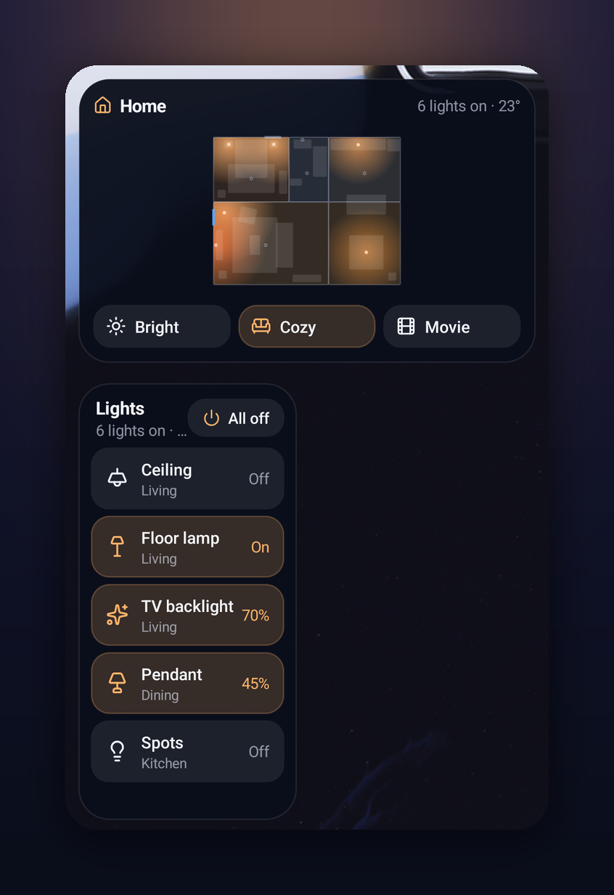

<!-- English: [README.md](README.md) · 简体中文：README.zh-CN.md -->

<p align="center">
  
</p>

<h1 align="center">House Control 安卓版</h1>

<p align="center">
  把你的家变成手机和平板上的实时 3D 模型 ——<br>
  通过 Smart Life、Home Assistant 和 Philips Hue 控制它的灯光、空调和场景。不需要 Mac。
</p>

<p align="center">
  <a href="#安装"><b>安装</b></a> &nbsp;·&nbsp;
  <a href="#自行构建"><b>自行构建</b></a> &nbsp;·&nbsp;
  <a href="#支持项目"><b>支持项目</b></a>
</p>

<p align="center">
  由 <a href="https://x.com/0xProbabillity">@0xProbabillity</a> 打造 · 是 Mac 与 iPhone 版
  <a href="https://github.com/0xProbabillity/house-control">House Control</a> 的安卓姊妹项目，
  以及 <a href="https://github.com/0xProbabillity/house-control-tv">House Control TV</a>
</p>

<p align="center">
  
</p>

## 它能做什么

- **你的 3D 户型图。** 房间、墙体、门窗和家具都由同一份 JSON 户型图绘制 —— 和 Mac 与 iPhone 版 House Control
  用的是同一份户型图、同一套渲染器。灯点亮场景的方式，和点亮房间的方式一样；运转起来的空调会吹出看得见的风。
- **灯光。** 在 3D 视图里或磁贴上点一下灯就能开关，在磁贴上横向拖动可以调暗，长按则可以调节亮度、色温和颜色。
- **空调。** 开关、目标温度、模式、风速、扫风、睡眠和节能 —— 机型提供什么就有什么 —— 如果你有真实传感器，
  房间温度也来自它。
- **场景。** 一下点中就能设定所有灯和空调："Cozy"、"Movie"、"Night"，或者你自己建的场景。
- **专为手指设计的户型图编辑器。** 画房间、摆家具、放置灯和空调、双指缩放，再把每一个都链接到真实设备 ——
  全都在手机上完成。
- **你的设备。** Smart Life / Tuya（用 Smart Life 应用扫一个 QR 码，不需要开发者账号）、Home Assistant
  （以及它支持的上千个品牌）和 Philips Hue，可以自由混搭在同一个家里。你 Wi-Fi 上的 Home Assistant 服务器和
  Hue Bridge 会被自动发现。
- **小组件、快捷方式和一个磁贴。** 主屏幕上有一个俯视角度的家的模型，灯亮着各自的颜色，还有场景和一份灯光列表；
  应用图标的菜单里有场景；快捷设置里有 *All lights*。每一次点击都直接操作真实设备，不用打开应用。
- **手机和平板，横放竖放都行。** 横过来放时，模型能占满面板旁边的整块高度。
- **可选：你的电脑。** 和 Mac 或 Windows PC 上的 House Control 配对后，户型图、设备链接以及 Home Assistant
  和 Hue 的连接在两边都保持一致，无论你在哪一边编辑。
- **没有任何硬件也能用。** 在你接入真实设备之前，所有设备都是模拟的，你可以先把功能都试一遍。

<p align="center">
  
</p>

<p align="center">
  
</p>

| 平台 | 手机如何连接 |
| --- | --- |
| ✓ **Smart Life / Tuya** | 它自己的登录方式：用一个 QR 码，用 Smart Life 应用扫一下。支持灯、插座、Wi-Fi 空调，以及红外发射器后面的红外空调 |
| ✓ **Home Assistant** | 你自己网络内服务器的 API，配一个长效访问令牌。Wi-Fi 上自动发现 |
| ✓ **Philips Hue** | Hue Bridge 的本地 API（CLIP v2）：按一下它的按钮即可。Wi-Fi 上自动发现 |
| — **Apple Home** | HomeKit 只存在于 Apple 设备上。把 HomeKit 或 Matter 配件接入 Home Assistant，就能在这里控制它们 |

## 语言

House Control 支持英文和简体中文。

应用跟随手机的语言。原生界面（**Settings**、**Devices**、各个连接页）从 Android 自己的资源里读文字；
在 WebView 里跑的 3D 家、面板和户型图编辑器，则从随应用一起走的词典里读同样的措辞。英文是默认语言，
词典里没有的标签就按原样显示。

- **英文**（默认）—— `app/src/main/res/values/strings.xml`，以及 web UI 里的英文原文。
- **简体中文** —— `app/src/main/res/values-zh-rCN/strings.xml` 和 `web/src/locales/zh-CN.js`。

在 Android 13 及更高版本上，应用的语言也列在 **Settings → Apps → House Control → Language** 里；
更早的版本则跟随系统语言。

[English description](README.md)

想要别的语言？加一份同名的 `values-xx/strings.xml`，在 `web/src/locales/` 下加一个词典，
再在 `app/src/main/res/xml/locales_config.xml` 里列出它就行，别的地方都不用改。

## 安装

1. 从 [Releases](../../releases) 下载 `house-control-<version>.apk`。
2. 在手机上打开它。Android 会问一次，是否允许从你的浏览器或文件管理器安装应用：
   **Settings → Apps → Special app access → Install unknown apps**。
3. 打开 **House Control**。它以欢迎页和一个演示之家启动，你可以先四处看看。

或者用电脑配合 [ADB](https://developer.android.com/tools/releases/platform-tools)：

```bash
adb install -r house-control-1.0.0.apk
```

每个版本都会列出 APK 的 SHA-256 以及它签名证书的指纹，方便你核对自己下载到的文件：

```bash
shasum -a 256 house-control-1.0.0.apk
apksigner verify --print-certs house-control-1.0.0.apk
```

### 环境要求

| | |
| --- | --- |
| Android | 8.0（API 26）或更高，手机、平板均可 |
| WebView | Android System WebView 或 Chrome 100 及以上（Play Store 会持续更新） |
| 图形 | OpenGL ES 3.0 —— 过去十年里的手机都支持 |

## 初始设置

所有设置都在手机上完成，位于 **Settings**（面板顶部的滑块按钮）里：

- **New home** 开始你自己的户型图 —— 一个空房间，或者从 Studio 或 Apartment 布局改 —— 并打开编辑器。
  **Import file** 可以导入任何从 House Control 导出的户型图 JSON（[格式说明](https://github.com/0xProbabillity/house-control/blob/main/docs/floor-plan.md)）。
- **Edit floor plan** 是为手指重新排布过的 House Control 编辑器：点房间、灯或空调选中它，拖动选中的东西，
  在别处拖动就是平移，双指缩放。**Add**、**Items**、**3D** 和 **Home** 排在底部；**Done** 负责保存。
  Android 的返回键会先关闭弹层，再关闭编辑器（并询问是否有未保存的改动）。
- **Devices** 按房间列出户型图里的每一盏灯和每一台空调；点其中一个，再从你已连接平台的所有设备里挑出对应的
  那台真实设备；也可以用 **Add devices to a room** 一次放入多个，并直接建立好链接。
- **Smart Life**、**Home Assistant** 和 **Philips Hue** 都在这里直接连接。

### Smart Life

打开 *Smart Life → Me → Settings → Account and Security*，取出 User Code 并选择 **Show sign-in code**。
这个码必须由 Smart Life 应用来扫 —— 而它通常就装在你正拿着的这台手机上。所以先点 **Save code to
the gallery**，然后在 Smart Life 里点 **+ → Scan**，再点相册图标，选中那个码。**Share code** 把它发到
任意另一块屏幕，已经配对过的 Mac 或 PC 会自己显示它。会话留在手机里，用一把绝不离开手机的密钥加密；
应用打开期间，每 12 秒读一次 Smart Life。

### Home Assistant

Wi-Fi 上的服务器会自己列出来；点一个，或者手动输入地址（例如
`http://homeassistant.local:8123`）。从 Home Assistant 的个人资料里 Home Assistant →
*Security* → *Long-lived access tokens* 复制一个长效访问令牌粘贴进来。`light.*` 和 `switch.*` 实体会变成灯，
`climate.*` 实体会变成空调，温度传感器可以充当空调的房间温度计。其他地方做出的改动会通过 Home Assistant 的
WebSocket 即时传过来。

### Philips Hue

在 Bridge 旁边点 **Pair**（或者从 Hue 应用 → *Settings → My Hue system* 里输入它的地址），然后在一分钟内按下
Bridge 上那个圆形按钮。灯、灯带和插座都能用；Hue 动作传感器里的温度计可以作为空调的房间温度。
Bridge 的事件流会把 Hue 应用里的改动即时带过来。

### 与 Mac 或 PC 同步（可选）

手机和 Mac 上的 [House Control](https://github.com/0xProbabillity/house-control)，或者 PC 上的
[House Control for Windows](https://github.com/0xProbabillity/house-control-windows)，配对方式完全一样。

1. 在电脑上：右键点击 House Control 图标 —— Mac 上在菜单栏，PC 上在任务栏的托盘 ——
   → **Pair Phone…**（旧版本是 **Pair iPhone…**）。会出现一个 QR 码。
2. 在手机上：**Settings → Pair with Mac or PC → Scan the code**（或者在电脑上点 **Copy Pairing
   Link** 之后，用 **Paste pairing link**）。

从此以后，只要两边连在同一个 Wi-Fi 上、应用都开着，在一边保存的户型图很快就会同步到另一边。先在手机上
建立的家会先传到电脑。如果两边在分开期间都改过户型图，手机会问你要保留哪一个。Home Assistant 和 Hue 的
连接也会一起过去；Smart Life 的会话不会（Tuya 会轮换它的令牌），但电脑会替你填好 User Code。

全程不经过任何服务器：手机用 DNS-SD（Bonjour）找到电脑，双方用 TLS 1.2 通信，预共享密钥只存在于 QR 码里
（`TLS_PSK_WITH_AES_128_GCM_SHA256`，和 iPhone 版一样），所以没见过这个码的设备连不上。

## 小组件、快捷方式与快捷设置



- **Home** —— 俯视角度的你的家，每一盏亮着的灯都发出自己的颜色，还有它的状态和场景。
  点一下户型图就能打开应用。
- **Scenes** —— 一下点中就能设定所有灯和空调。
- **Lights** —— 每一盏灯连同它的亮度；点一下可以单独开关，也可以一次全部切换。
- **All lights** —— 一个快捷设置磁贴：从通知栏里一键全关（或全开）。
- **App shortcuts** —— 长按应用图标就能看到你的场景；在 **Settings → App shortcuts** 里挑哪些要留下
  （场景、灯、*All lights off*），还可以把其中一个拖出来固定在主屏幕上。

小组件自己就能切换设备，不用打开应用：它直接把命令发给 Smart Life、Home Assistant
或 Hue，面板会在下次打开时显示新的状态。
<br clear="right">

## 隐私与安全

House Control 只和你接入的平台通信 —— Smart Life 走 Tuya 的服务器，还有你自己的 Home Assistant、你的 Hue
Bridge —— 以及你配对过的 Mac 或 PC，此外哪儿都不去。它没有账号，没有埋点分析，也没有自己的后端。

- 户型图存放在应用的私有存储里。
- Smart Life 会话、Home Assistant 令牌、Hue 密钥和电脑的配对密钥都用 AES-GCM
  加密，密钥保存在不可导出的 Android Keystore 密钥下，并且不进入备份。**Sign out** / **Disconnect** /
  **Unpair** 会把它们删掉。任何日志里都不会出现令牌或密钥。
- Hue Bridge 的证书是自签名的：手机在配对时信任它，记下它的 SHA-256 指纹，此后拒绝该地址上的任何其他设备。
- Home Assistant 在家庭网络上通常是通过明文 `http://` 访问的，所以应用允许明文流量；
  如果服务器要走公网，请使用 `https://`。
- Web UI 随应用打包，由应用自己的资源提供；它绝不会从互联网上加载任何东西。

## 自行构建

你需要 JDK 17、Android SDK（platform 36、build-tools 36）以及 Node.js 20.19+ 或 22.12+。

```bash
git clone https://github.com/0xProbabillity/house-control-android.git
cd house-control-android
./gradlew assembleDebug
adb install -r app/build/outputs/apk/debug/app-debug.apk
```

首次构建会安装 Web UI 的 npm 依赖；Gradle 用 Vite 构建 Web UI，再把它打包进应用。
调试版会装在正式版旁边（`dev.housecontrol.android.debug`）。

签名的正式版构建会从 `.signing/release.properties`（`storeFile`、`storePassword`、`keyAlias`、
`keyPassword`）或 `HOUSE_SIGNING_*` 环境变量读取密钥，这两处都不在仓库里：

```bash
./gradlew assembleRelease
```

在模拟器里试试：

```bash
sdkmanager "system-images;android-36;google_apis;arm64-v8a"
avdmanager create avd -n house -k "system-images;android-36;google_apis;arm64-v8a" -d pixel_8
emulator -avd house &
./gradlew installDebug
```

模拟器看不到 Mac 的 Bonjour 广播，那就让调试版直接指向 Mac：
`adb shell am start -n dev.housecontrol.android.debug/dev.housecontrol.android.MainActivity --es syncEndpoint 10.0.2.2:<port>`。

## 开发

```
app/      the Android app (Kotlin): the web UI in a WebView with its JSON bridge, the native screens (Jetpack
          Compose), the device platforms, the Mac sync, widgets (Glance), shortcuts and the Quick Settings tile
web/      the UI from House Control: Three.js scene, panel and editor (Vite), with the Android bridge and layouts
scripts/  make-icons.mjs turns the Lucide icons the web UI uses into Android vector drawables
docs/     screenshots
```

设备平台部分是 House Control 的 Swift 核心（`DeviceHub`、Home Assistant、Hue、Smart Life
和 Tuya、红外遥控、户型图编辑器、小组件快照和同步协议）的 Kotlin 移植版。单元测试跑的用例和 Swift 测试
完全一致 —— 包括拿 CryptoKit 向量校验 Smart Life 信封 —— 以及对着一个类似 Mac 端的服务做 TLS-PSK
握手：

```bash
./gradlew testDebugUnitTest
```

在浏览器里做 UI 开发，带热重载；在那里原生桥接是空操作，所有设备都是模拟的：

```bash
cd web && npm install && npm run dev
```

然后打开 `http://localhost:5199/?platform=android`。加上 `&mode=editor` 进入编辑器，加上 `&plan=studio`
打开第二份演示户型图。Web UI 来自 [House Control](https://github.com/0xProbabillity/house-control)（版本记录在
`UPSTREAM-REVISION`，许可证在 `UPSTREAM-LICENSE`）。

## 支持项目

<picture>
  <source media="(prefers-color-scheme: dark)" srcset="docs/support/banner-dark.svg">
  <source media="(prefers-color-scheme: light)" srcset="docs/support/banner-light.svg">
  
</picture>

House Control 免费且没有广告。如果它在你手机上占了一个位置，用加密货币打个小赏能帮它继续长大：
更多设备、更多平台、更快的修复。谢谢你！点个 star、报个 bug 或者提个 pull request 同样有用。

用钱包扫一下码，或者点方框角落的按钮复制地址。

> [!IMPORTANT]
> 每种币只走它地址旁边标注的那个网络。用别的网络发送可能会丢失。

<table>
  <tr>
    <td align="center" width="196">
      
    </td>
    <td>
      &nbsp;
      <b>Bitcoin</b>
      <br><sub>BTC · 原生 SegWit (bech32) 地址</sub>

```text
bc1q07hfz95crdalcrnywjavdpc4pdvllct83as5re
```

    </td>
  </tr>
  <tr>
    <td align="center" width="196">
      
    </td>
    <td>
      
      
      
      &nbsp;
      <b>Ethereum · Base · BNB Chain · Arbitrum</b>
      <br><sub>一个地址通吃四条网络 · ETH、BNB、USDT、USDC 等代币</sub>

```text
0x4ed3aF428e938a0CC8e60df86D714B4a7F0928F0
```

    </td>
  </tr>
  <tr>
    <td align="center" width="196">
      
    </td>
    <td>
      &nbsp;
      <b>TON</b>
      <br><sub>TON 上的 Toncoin 与 USDT · 无需填 memo</sub>

```text
UQBCDKDp11tBIwTon4ItzTPcQgNGcaqTM6Gn31KwSN7qWdmM
```

    </td>
  </tr>
  <tr>
    <td align="center" width="196">
      
    </td>
    <td>
      &nbsp;
      <b>TRON</b>
      <br><sub>TRX 和 USDT (TRC-20)</sub>

```text
TWtWLJp2Hc6242RynhU1B4Uujru3tppb3B
```

    </td>
  </tr>
</table>

## 致谢与免责声明

Smart Life 的登录方式遵循 Tuya 的开源项目
[`tuya-device-sharing-sdk`](https://github.com/tuya/tuya-device-sharing-sdk)，也就是 Home Assistant 里 Tuya
集成背后的那个库，House Control 也是这么做的。3D 视图基于 [Three.js](https://threejs.org) 构建；图标来自
[Lucide](https://lucide.dev)；与 Mac 之间的加密连接使用 [Bouncy Castle](https://www.bouncycastle.org)；
QR 码由 [ZXing](https://github.com/zxing/zxing) 生成和识别。[支持项目](#支持项目) 下面的网络图标来自
[Web3 Icons](https://github.com/0xa3k5/web3icons)（MIT）。

本项目与 Tuya、Smart Life、Home Assistant、Signify（Philips Hue）、Google
或 Apple 均无隶属关系，也未得到它们的背书。它依赖的接口这些公司随时可能变更。使用风险自负。

## 许可协议

[MIT](LICENSE)
